# CodeRadar — Architectural Diagrams and Workflows

This document contains 20 comprehensive Mermaid diagrams depicting the end-to-end architecture, data flows, operational cycles, and algorithmic state machines of CodeRadar.

---

## 1. System Architecture

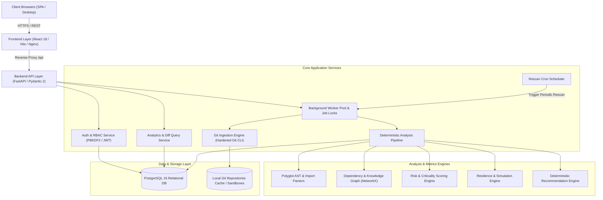

---

## 2. Frontend / Backend / Database Architecture

```mermaid
flowchart LR
    subgraph Frontend ["Frontend (React 18 + TypeScript)"]
        UI_Pages["Pages: Dashboard, Modules, Devs, Sim, Recs, History, Settings"]
        UI_Context["AuthContext (JWT Session & State)"]
        UI_API["Typed API Client (Fetch + Error Normalizer)"]
    end

    subgraph Backend ["Backend (FastAPI + SQLAlchemy 2)"]
        API_Routers["Routers: /auth, /projects, /analytics, /simulations, /health"]
        Middlewares["Security Headers + Request Correlation + Timing"]
        Auth_Guard["RBAC Guards (owner, analyst, viewer)"]
        Workers["Async Thread Worker Pool & Concurrency Locks"]
    end

    subgraph Database ["Database (PostgreSQL 16)"]
        Auth_Tables[("users, project_members, audit_logs")]
        Core_Tables[("projects, repositories, files, modules")]
        Metrics_Tables[("commits, authors, knowledge_scores, risk_scores")]
        Analysis_Tables[("analysis_runs, resilience_scores, recommendations")]
    end

    UI_Pages --> UI_Context
    UI_Pages --> UI_API
    UI_API -->|JSON over HTTP| API_Routers
    API_Routers --> Middlewares
    Middlewares --> Auth_Guard
    Auth_Guard --> Workers
    Workers --> Database
    API_Routers --> Database
```

---

## 3. Repository Ingestion Workflow

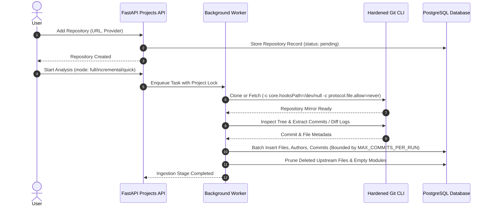

---

## 4. Git Analysis Pipeline

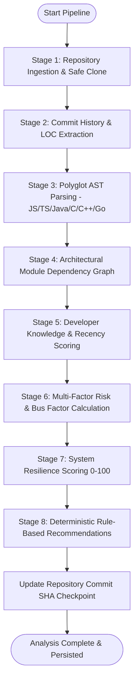

---

## 5. Repository Rescan Workflow

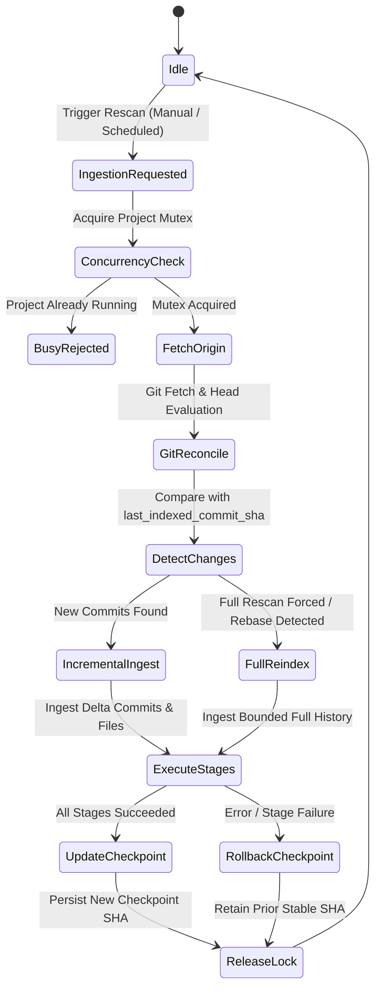

---

## 6. Incremental versus Full Rescan Workflow

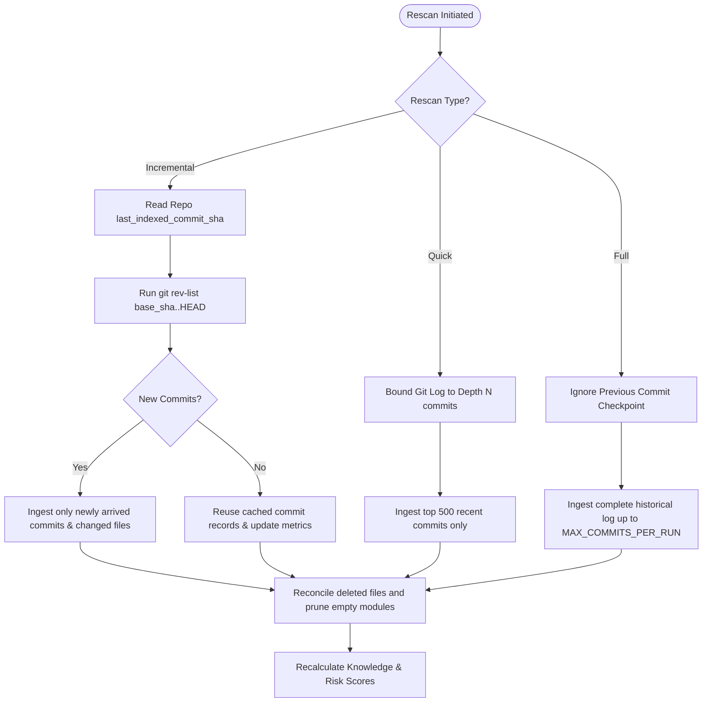

---

## 7. Background Job Workflow & Concurrency Control

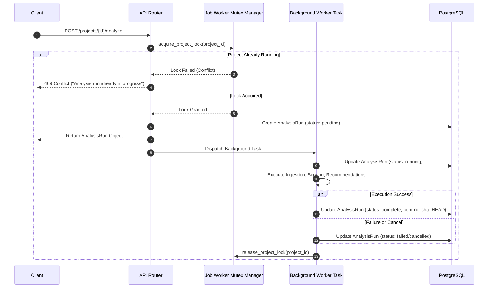

---

## 8. Authentication and Authorization Flow (RBAC)

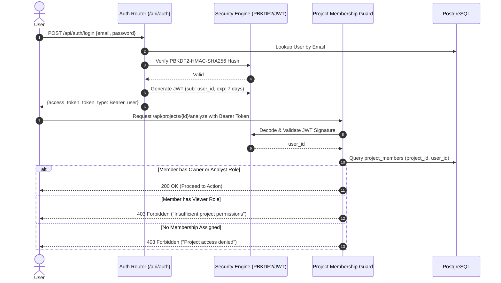

---

## 9. Database Entity-Relationship (ER) Diagram

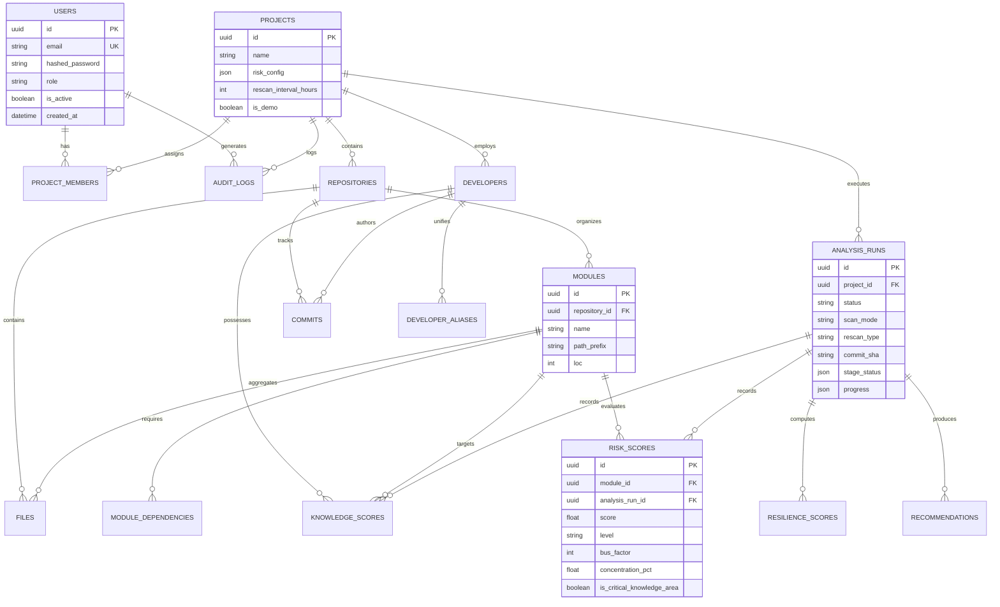

---

## 10. Developer-Module Knowledge Graph

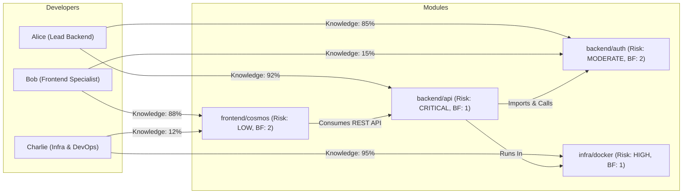

---

## 11. Multi-Factor Risk Scoring Workflow

```mermaid
flowchart TD
    ModData[Module Git Activity & Code Structure] --> Factor1[1. Knowledge Concentration (0-1)]
    ModData --> Factor2[2. Bus Factor Inverted Risk (0-1)]
    ModData --> Factor3[3. Documentation Deficit (0-1)]
    ModData --> Factor4[4. Cyclomatic Complexity Score (0-1)]
    ModData --> Factor5[5. Code Churn in Past 90d (0-1)]
    ModData --> Factor6[6. In-Degree & Out-Degree Centrality (0-1)]

    Config[Project Risk Weights Configuration] --> WeightSum[Weighted Linear Combination]
    Factor1 --> WeightSum
    Factor2 --> WeightSum
    Factor3 --> WeightSum
    Factor4 --> WeightSum
    Factor5 --> WeightSum
    Factor6 --> WeightSum

    WeightSum --> RawScore[Raw Module Risk: 0.0 to 100.0]
    RawScore --> LOCShare[Module LOC Share Adjustment]
    LOCShare --> FinalRisk[Final Module Risk Score]

    FinalRisk --> Categorize{Risk Level}
    Categorize -->|Score < 30| Low[LOW]
    Categorize -->|30 <= Score < 55| Moderate[MODERATE]
    Categorize -->|55 <= Score < 75| High[HIGH]
    Categorize -->|Score >= 75| Critical[CRITICAL]
```

---

## 12. Bus Factor Calculation Workflow

```mermaid
flowchart TD
    StartMod[Select Module] --> FilterCommits[Filter Commits within Recency Window]
    FilterCommits --> ApplyDecay[Apply Exponential Half-Life Decay: 0.5 ^ (age / half_life)]
    ApplyDecay --> SumAuthorScores[Compute Effective Author Ownership Shares]
    SumAuthorScores --> SortAuthors[Sort Authors Descending by Normalized Share]
    SortAuthors --> InitLoop[Set Cumulative Share = 0, Count = 0]
    InitLoop --> NextAuthor[Add Next Author Share to Cumulative]
    NextAuthor --> CheckThreshold{Cumulative Share >= Threshold (e.g. 80%)?}
    CheckThreshold -->|No| IncrCount[Increment Count by 1] --> NextAuthor
    CheckThreshold -->|Yes| BusFactorResult[Bus Factor = Count + 1]
    BusFactorResult --> Output[Assign Bus Factor to Module Record]
```

---

## 13. System Resilience Analysis Workflow

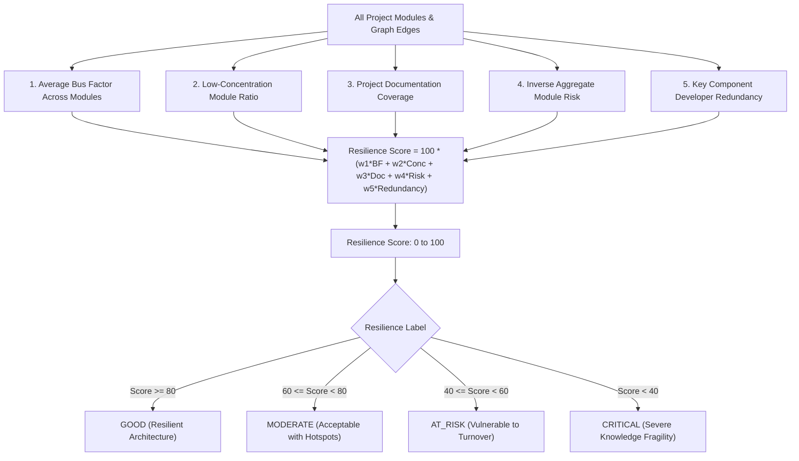

---

## 14. Developer Unavailability Simulation

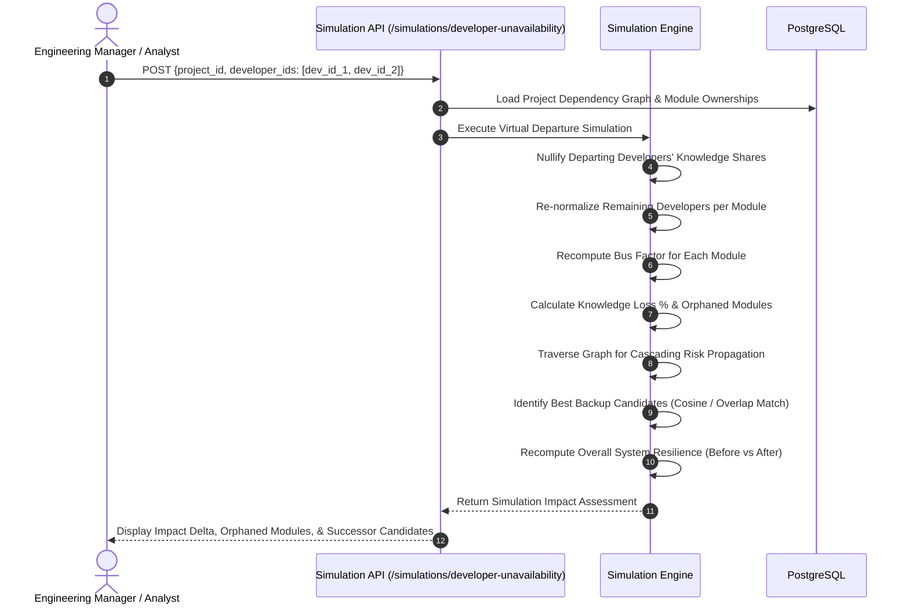

---

## 15. Rule-Based Deterministic Recommendation Engine

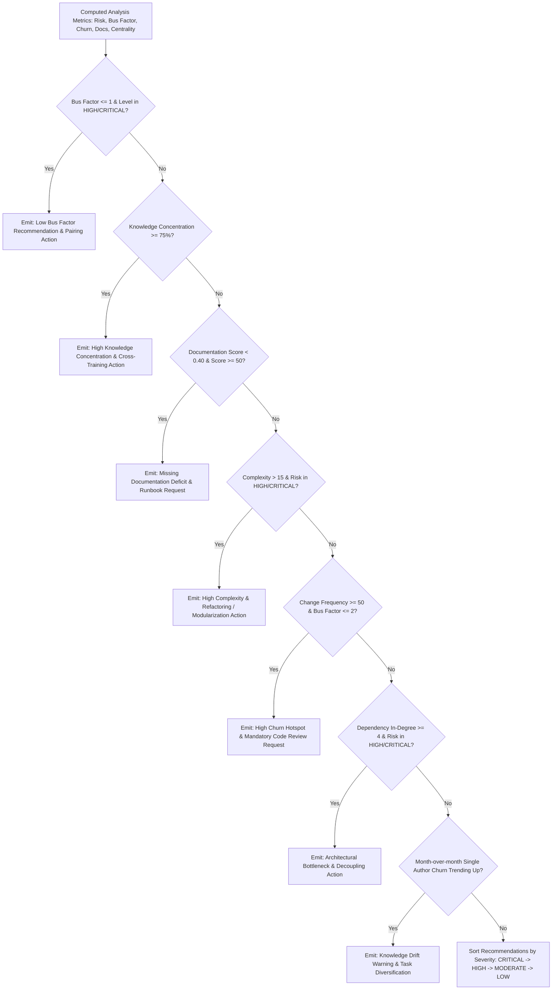

---

## 16. Deployment Architecture

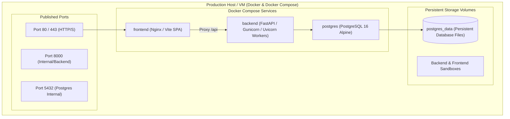

---

## 17. CI/CD Pipeline Workflow

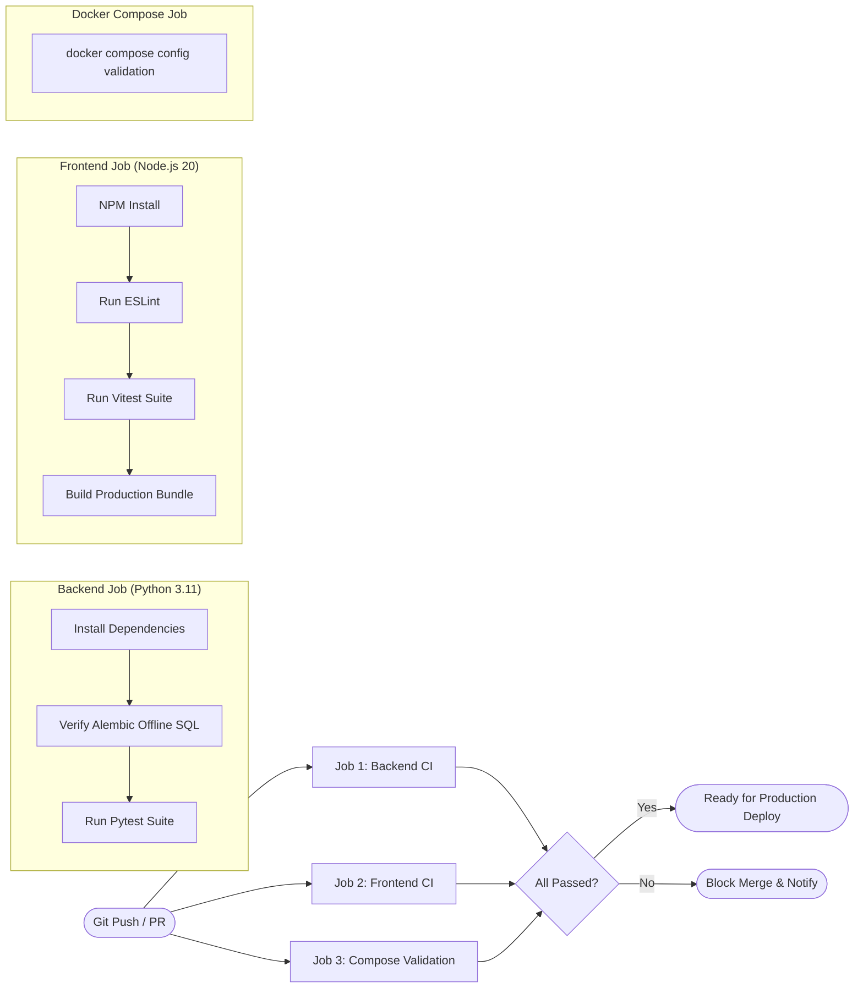

---

## 18. Error Handling and Safe Rollback Workflow

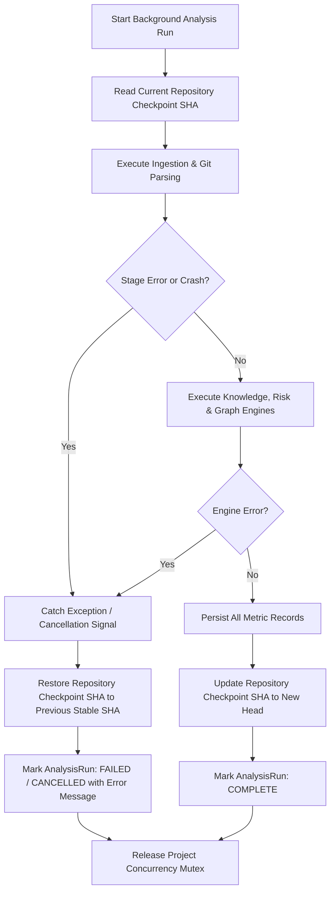

---

## 19. Historical Analysis Snapshot Lifecycle

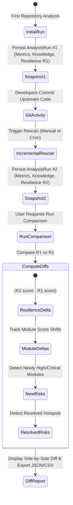

---

## 20. Scheduled Rescan Workflow

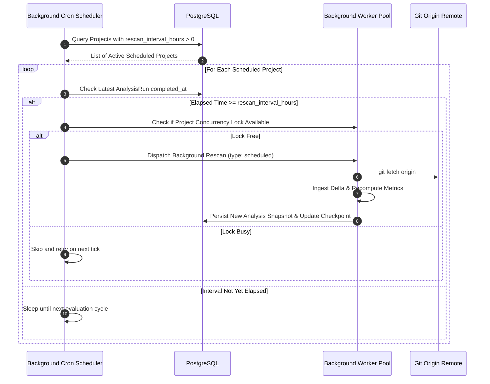
