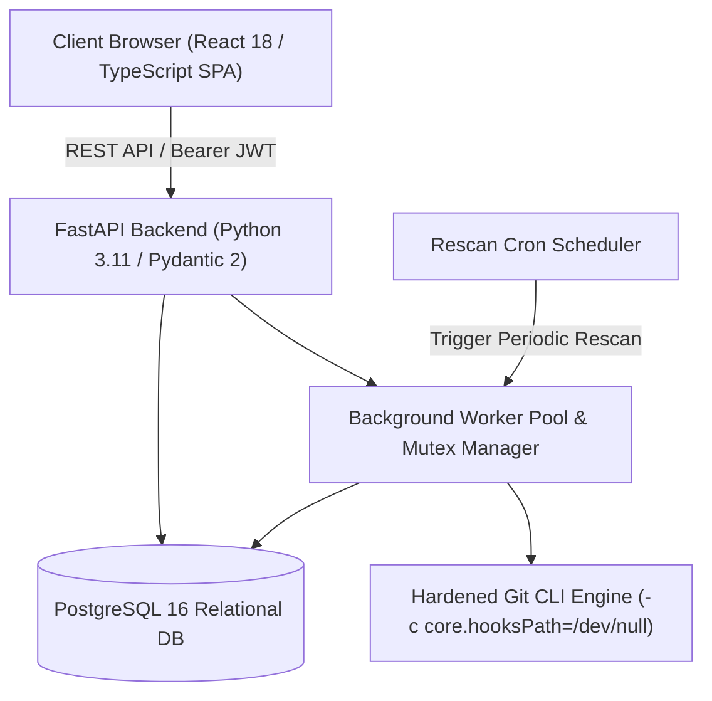

# CodeRadar

**CodeRadar** is a secure, reliable, and deterministic repository intelligence and software engineering risk analysis platform.

It analyzes Git repositories and source code to identify:
- **Developer knowledge concentration**
- **Developer-to-module ownership**
- **Software module risk & criticality**
- **Bus factor (single points of failure)**
- **Architectural dependencies & circular references**
- **System resilience (0 to 100)**
- **Developer unavailability simulation & succession planning**
- **Deterministic, rule-based risk recommendations**
- **Historical run comparisons and metric drift**

> [!IMPORTANT]
> **Ethical Engineering Guarantee**: CodeRadar is strictly a repository intelligence and engineering risk analysis platform, **never an employee productivity tracker or performance evaluation tool**. Git commit history serves exclusively as an engineering proxy for module familiarity and architectural risk, not as a measure of employee competence, productivity, or effort.

> [!NOTE]
> **Deterministic & Explainable (Zero AI / ML)**: CodeRadar operates entirely without external AI APIs, LLMs, or non-deterministic ML models. All calculations, bus factor metrics, risk categorizations, and recommendations are mathematically reproducible, auditable, and transparent.

---

## Architecture Overview



---

## Core Platform Capabilities

- **Multi-Factor Risk Scoring**: Evaluates modules across 6 weighted dimensions: knowledge concentration, bus factor, documentation deficit, cyclomatic complexity, code churn, and architectural centrality.
- **Configurable Risk Models**: Dynamically customize factor weights, criticality thresholds, and exponential recency decay half-life per project.
- **Rescan Engine**: Supports **Incremental Rescan** (deltas since last checkpoint), **Quick Scan** (bounded-depth preview), and **Full Historical Rescan** with safe Git reconciliation and checkpoint rollback on failure.
- **Background Worker Pool**: Isolated thread pool with per-project mutual exclusion concurrency locks, stale run recovery on startup, and cancellation support.
- **Automated Rescan Scheduling**: Built-in background cron scheduler supporting daily (24h) and weekly (168h) automatic project rescans.
- **Authentication & RBAC**: PBKDF2-HMAC-SHA256 password hashing (600,000 iterations), JWT Bearer authentication, and role-based access control (`owner`, `analyst`, `viewer`).
- **Comprehensive Audit Trail**: Tracks all user actions (rescan requests, member changes, project configuration updates, cancellations) in an immutable log.
- **Hardened Git Security**: Protected against SSRF and command injection with `-c core.hooksPath=/dev/null`, `-c protocol.file.allow=never`, DNS resolution checks, and URL scheme whitelisting.
- **Polyglot Code Parsing**: Static AST and heuristic parsers for Python, JavaScript, TypeScript, Java (import extraction), C, C++, and Go, with circular dependency detection.
- **Knowledge Transfer Planning**: Generates structured 6-point knowledge transfer curriculums for high-risk and single-owner modules.
- **Historical Comparison & Data Export**: Side-by-side run diffs, resilience drift tracking, and full JSON and CSV export endpoints.

---

## Quick Start (Docker Compose — Recommended)

The fastest and most reliable way to run CodeRadar is using Docker Compose:

```bash
# 1. Clone the repository and enter directory
cd CodeRadar

# 2. Ensure environment configuration exists
cp .env.example .env

# 3. Start all services (PostgreSQL, Backend API, Frontend SPA)
docker compose up --build
```

The application will be accessible at:
- **Frontend SPA**: `http://localhost:5173`
- **Backend REST API**: `http://localhost:8000`
- **Interactive OpenAPI Documentation**: `http://localhost:8000/docs`
- **Health Check Endpoint**: `http://localhost:8000/api/health/ready`

---

## Manual Local Development

### 1. Backend Setup (FastAPI & PostgreSQL)

```bash
cd backend
python -m venv .venv

# On Linux/macOS:
source .venv/bin/activate
# On Windows (PowerShell):
.venv\Scripts\activate

pip install -r requirements.txt
cp ../.env.example ../.env

# Apply database migrations
alembic upgrade head

# Start API server with auto-reload
uvicorn app.main:app --host 0.0.0.0 --port 8000 --reload
```

### 2. Frontend Setup (React 18 & Vite)

```bash
cd frontend
npm install
npm run dev
```

The Vite dev server runs at `http://localhost:5173` and automatically proxies `/api` requests to the backend server at `http://localhost:8000`.

---

## Automated Test Verification

All automated test suites have been verified with a 100% pass rate:

```bash
# 1. Backend Pytest Suite (57 passed in ~26s)
cd backend
pytest tests -v

# 2. Frontend Unit Tests (11 passed)
cd frontend
npm test -- --run

# 3. Frontend Production Build & TypeScript Check
cd frontend
npm run build

# 4. Frontend ESLint Check (0 errors, 0 warnings)
cd frontend
npm run lint

# 5. Alembic Offline Migration Check
cd backend
alembic upgrade head --sql
```

---

## Documentation Index

All project documentation is consolidated in the [`Documentation/`](Documentation/) directory:

| Document | Description |
|---|---|
| [`Documentation/PROJECT_MASTER_CONTEXT.md`](Documentation/PROJECT_MASTER_CONTEXT.md) | Master context reference, architectural boundaries, and core design guarantees. |
| [`Documentation/ARCHITECTURE.md`](Documentation/ARCHITECTURE.md) | Detailed system architecture, component breakdown, and service responsibilities. |
| [`Documentation/DIAGRAMS.md`](Documentation/DIAGRAMS.md) | **20 comprehensive Mermaid diagrams** covering all architecture, ingestion, rescan, and security flows. |
| [`Documentation/DETERMINISTIC_ANALYSIS_DOCUMENTATION.md`](Documentation/DETERMINISTIC_ANALYSIS_DOCUMENTATION.md) | Mathematical formulas, bus factor algorithms, recency decay, and rule-based recommendation engine. |
| [`Documentation/DATABASE_SCHEMA.md`](Documentation/DATABASE_SCHEMA.md) | Database entity models, relations, indexes, and Alembic migration history. |
| [`Documentation/API_DOCUMENTATION.md`](Documentation/API_DOCUMENTATION.md) | Complete REST API specification with endpoints, request/response payloads, and authentication. |
| [`Documentation/SECURITY_AUDIT.md`](Documentation/SECURITY_AUDIT.md) | Threat modeling, RBAC permissions matrix, SSRF mitigations, and Git subprocess hardening. |
| [`Documentation/TESTING_DOCUMENTATION.md`](Documentation/TESTING_DOCUMENTATION.md) | Automated testing strategy, Pytest and Vitest test suites, and execution evidence. |
| [`Documentation/DEVOPS_DOCUMENTATION.md`](Documentation/DEVOPS_DOCUMENTATION.md) | Containerization, Docker Compose configuration, healthcheck orchestration, and CI/CD. |
| [`Documentation/PROJECT_STATUS.md`](Documentation/PROJECT_STATUS.md) | Production-readiness audit report, requirements compliance matrix, and verification summary. |
| [`Documentation/IMPLEMENTATION_PROGRESS.md`](Documentation/IMPLEMENTATION_PROGRESS.md) | Chronological implementation history, completed phases, and verification logs. |
| [`Documentation/ANALYSIS_METHODOLOGY.md`](Documentation/ANALYSIS_METHODOLOGY.md) | Technical methodology for knowledge scoring, ownership attribution, and drift detection. |
| [`Documentation/RISK_MODEL.md`](Documentation/RISK_MODEL.md) | Multi-factor risk calculation model, criticality scaling, and resilience formulas. |
| [`Documentation/DEMO_GUIDE.md`](Documentation/DEMO_GUIDE.md) | Synthetic demo dataset generation guide and step-by-step walkthrough. |
| [`Documentation/PERFORMANCE_BENCHMARKS.md`](Documentation/PERFORMANCE_BENCHMARKS.md) | Measured benchmarks for incremental indexing, Git commit extraction, and database operations. |
| [`Documentation/PRODUCTION_READINESS_AUDIT.md`](Documentation/PRODUCTION_READINESS_AUDIT.md) | Initial repository audit and technical readiness evaluation. |

---

## License

CodeRadar is licensed under the Apache 2.0 License.
